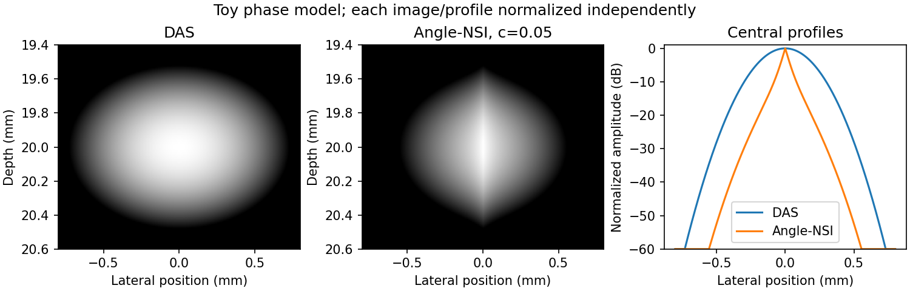

# Angle-domain null subtraction imaging

Python implementation of **[Angle-domain null subtraction imaging
from beamformed plane-wave data](https://arxiv.org/abs/2608.18252)**.
Release **v1.2.1** preserves the final 15 October 2026 numerical snapshot and
adds a small interface for applying Angle-NSI to your own images.

Angle-NSI operates on **complex receive-beamformed images retained separately
for each transmit angle**. The core calculation runs on NumPy arrays without
CUDA, channel RF data, MACH or PyMUST. It requires the angular information and
relative phase before coherent compounding, envelope detection and log compression.

## Install and try the CPU example

Clone the repository and use Python 3.10 or newer. Python 3.12 is used for the
locked publication-replay environment.

```bash
git clone https://github.com/hacheleroy/angle_domain_NSI.git
cd angle_domain_NSI
python -m venv .venv
```

On Linux/WSL:

```bash
source .venv/bin/activate
python -m pip install ".[demo]"
python examples/quickstart.py
```

On Windows PowerShell, activation is optional:

```powershell
.\.venv\Scripts\python.exe -m pip install ".[demo]"
.\.venv\Scripts\python.exe examples\quickstart.py
```

The example creates a small complex per-angle stack, linear DAS/Angle-NSI
envelopes and `results/generated/quickstart/quickstart.png`. Its paired-angle
phase model illustrates the operation; the paper's quantitative experiments
use the RF pipelines below. Each displayed image/profile is normalized
independently; the saved linear arrays retain the c-dependent amplitude scale.



For the NumPy-only API and CLI, install with `python -m pip install .`.
`[demo]` adds Matplotlib. The package is installed from this repository;
no PyPI publication is assumed.

## Apply Angle-NSI to your images

```python
import numpy as np
from angle_nsi import angle_nsi

# images: complex64 or complex128, shape (depth, lateral, angle)
# angles_deg: increasing, symmetric steering angles in degrees
angle_envelope = angle_nsi(images, angles_deg, c=0.05, angle_axis=-1)
das_envelope = np.abs(images.sum(axis=-1))
```

The angle axis is removed; all other axes, including frame axes, are preserved.
The output is a nonnegative **linear envelope**, with no division by angle count
or c. NumPy inputs return NumPy results; optional CuPy inputs stay on the GPU.
See [input format and amplitude conventions](docs/INPUT_FORMAT.md) for shape,
phase, symmetry, weighting and output requirements.

To use an NPZ file, save `images` and `angles_deg` and run:

```bash
angle-nsi my_images.npz --output my_envelopes.npz --c 0.05 --angle-axis -1
```

`python -m angle_nsi` provides the same interface. On Windows, the corresponding
venv command is `.\.venv\Scripts\python.exe -m angle_nsi ...`.
The output contains `das`, `angle_nsi`, c and angle metadata; coordinate arrays
`x_mm`, `z_mm` and `time_s` are preserved when supplied. See
[the examples](examples/README.md) for a complete input-file recipe.

Symmetric nonuniform angle sets are supported. Asymmetric or incomplete sets
require explicitly redesigned null weights and are rejected by this interface.
An optional zero-degree transmission receives zero null weight.

A narrower apparent lateral response can accompany weaker targets and poorer
target/background separation. c is a task-dependent parameter; 0.05 is an
example setting, not a universal optimum. High-resolution power Doppler is a
promising intended use. The code cannot recover angular phase information
from a compounded or displayed B-mode image.

## Reproduce the accepted figures, tables and measurements

The Git checkout includes frozen numerical inputs and a separate reference
archive under `results/`. Manuscript LaTeX, compiled documents and reviewer
correspondence are maintained separately.

On Linux/WSL with CPython 3.12, use a separate environment for exact replay:

```bash
python3.12 -m venv .venv
source .venv/bin/activate
python -m pip install -e . -r requirements-test.txt
python scripts/reproduce_paper.py --check-only
python scripts/reproduce_paper.py
python -m unittest discover -s tests -v
```

`requirements-cpu.txt` locks direct and transitive CPU dependencies. Replay
writes `results/generated/paper_assets/` and checks **25 accepted assets**:
five main figures, ten supplementary figures, nine table fragments and one
numerical-macro file. Eight figures are redrawn from frozen arrays/measurements;
seven GPU-rendered figures are restored from reference images. Tables and
macros are regenerated from CSV/JSON records and checked against their accepted
SHA-256 hashes; no manuscript or `.tex` reference files are tracked.
Redraws retain reference PNG bytes after verification. Figure 4 permits at most
32 pixels to differ by one grayscale level because NumPy CPU instruction paths
round its float32 display transform differently. Every numerical-input hash
remains exact. The report lists redraws, restorations and rendering differences.

Tests remeasure all 42 method/target PSFs and their seven-target means/sample
SDs, check the saved CPU/GPU agreement, and reproduce the complete asset set.
[The reference manifest](results/reference/asset_manifest.json) records all
asset and numerical-input checksums. [Reproduction details](docs/REPRODUCIBILITY.md)
explain these boundaries and the measurement definitions.

| Main figure | Contents | Generation code |
|---|---|---|
| 1 | Simulated point target, six methods and profiles | `src/simulation_six_method_comparison.py`, `src/paper_replot.py` |
| 2 | Full experimental PICMUS phantom | `src/picmus_full_phantom_comparison.py` |
| 3 | MBTrace power Doppler | `src/doppler_mbtrace.py` |
| 4 | PICMUS longitudinal/cross-sectional carotid views | `src/conventional_baseline_comparison.py` |
| 5 | End-to-end and post-delay computation | `src/benchmark_scaling.py`, `src/benchmark_conventional.py` |

The six comparison methods are DAS, CF-DAS, MV, DMAS, Receive-NSI and Angle-NSI.
CF-DAS uses the receive-channel coherence factor per angle. DMAS uses delayed
RF pair products and a fixed band-pass around twice the carrier frequency.
USTB is an implementation reference; the reconstructions use Python/NumPy/CuPy.

## Recompute from public RF data

Full simulation, acquisition reconstruction and timing require a CUDA-capable
NVIDIA GPU and the additional dependencies in `requirements.txt`. Use a separate
environment from CPU replay, following [GPU setup and smoke checks](docs/GPU_SETUP.md).
The historical timing study used an RTX A2000; the software versions captured
by each study are retained in its JSON records.

```bash
python -m pip install -r requirements.txt
python -m pip install . --no-deps
python scripts/fetch_datasets.py --dataset all
python scripts/reproduce_paper.py --from-raw --device 0
```

The Open-NSI Box share may require a manual `MBTrace.mat` download. Locations,
source links and checksums are in [data/README.md](data/README.md).
New outputs go to `results/generated/revision/`, with figure/table fragments
in `manuscript_assets/`. The workflow includes robustness, grid convergence,
six-method simulation, MBTrace, carotid, full phantom, seven-target measurements,
inclusion gCNR and both timing boundaries. WSL stages retain isolated validated
checkpoints; `--force` is available in `scripts/run_revision_gpu.py` for reruns.

Fresh reconstructions and timings depend on hardware and software. The CPU
reference replay checks the accepted artifacts exactly. Full CUDA/RF execution
is outside CPU CI; the maintenance release validates CPU behavior, packaging
and replay without claiming a new end-to-end GPU run.

## Layout and licenses

```text
src/angle_nsi/                   Installable core API and NPZ CLI
src/                            Acquisition and comparison scripts
examples/                       CPU quick start and own-data recipe
results/reference/              Accepted figure images and all asset checksums
results/reported/paper_inputs/   Frozen numerical inputs for the final paper
results/reported/                Earlier release records and shared robustness data
results/generated/               New outputs, ignored by Git
scripts/                         Data acquisition and reproduction entry points
tests/                           API, algebra, measurement and publication regressions
docs/                            Input specification, environments and reproduction
```

Code is licensed under MIT. Committed result records, generated scientific
assets and documentation use CC BY 4.0; see [LICENSE](LICENSE) and
[LICENSE-DATA](LICENSE-DATA). External RF datasets retain their source terms
and are not redistributed.

## Citation

If you use this code or imaging technique in your research, please cite:

Henri Leroy (2026). **Angle-domain null subtraction imaging from beamformed
plane-wave data**.
[Paper](https://arxiv.org/abs/2608.18252) ·

```bibtex
@article{leroy2026angledomain,
  title   = {Angle-domain null subtraction imaging from beamformed plane-wave data},
  author  = {Leroy, Henri},
  journal = {arXiv preprint arXiv:2608.18252},
  year    = {2026},
  doi     = {10.48550/arXiv.2608.18252},
  url     = {https://arxiv.org/abs/2608.18252}
}
```

Machine-readable citation metadata are in [CITATION.cff](CITATION.cff).
Please also cite the relevant PICMUS, Open-NSI, PyMUST/MUST, MACH and
baseline-method publications when using those components.
